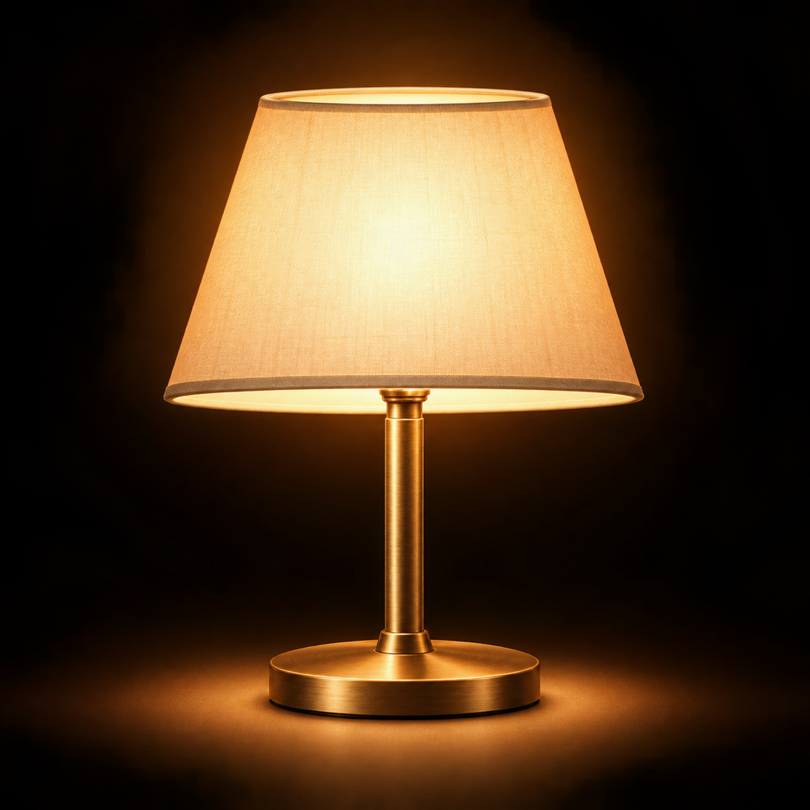
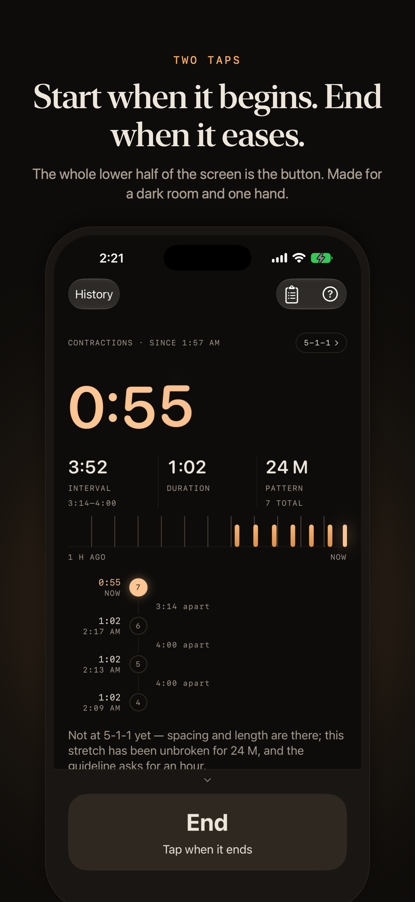
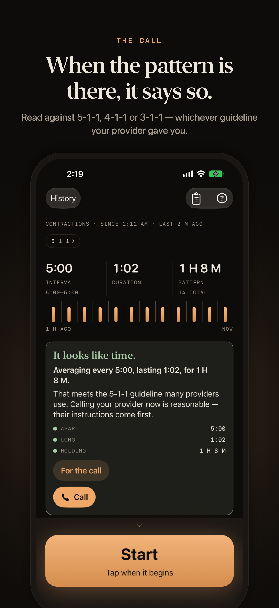
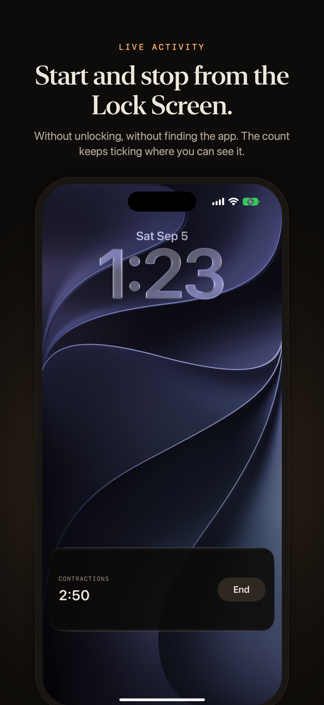
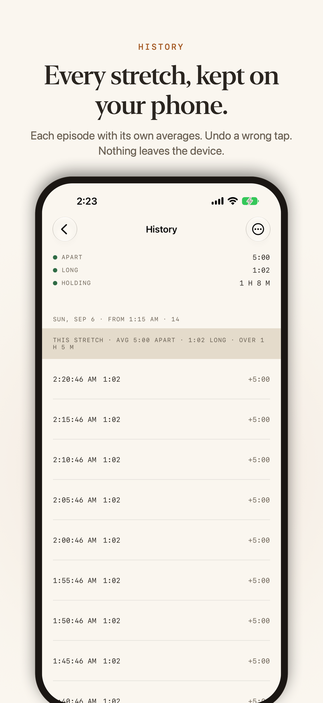

<p align="center">
  
</p>

# Hushlight

[](https://github.com/christianwainright/hushlight/actions/workflows/ci.yml)
[](LICENSE)


A contraction timer for the night labor starts. Free forever, with no ads, no
account, and no network. Everything you time stays on your phone.

Tap when a contraction starts and again when it ends. Hushlight times intervals
start to start (the clinical standard) and shows duration, spacing, and how long the
pattern has held against the guideline your provider gave you: 5-1-1, 4-1-1 or
3-1-1. When the pattern is there, it says so calmly and puts your provider's number
one tap away. It never diagnoses, and it never says *you are in labor*.

<p align="center">
  
  
  
  
</p>

**[On the App Store](https://apps.apple.com/app/id6806088681)** for iPhone, in fourteen storefronts. iPad arrives with 1.1.
Privacy policy and support: [christianwainright.com/hushlight](https://christianwainright.com/hushlight/support).

## What makes it different

- **Radically private, and enforced.** The app has no network capability, no
  entitlements, no App Group, no analytics and no third-party code. CI fails the
  build if a remote Swift package appears. Records live in the app's own sandbox and
  nowhere else.
- **No figure before its evidence.** No average shows until three contractions
  exist, and no verdict until the window really covers the rule. Where a figure
  has no evidence yet, the app shows an em dash, never a zero
  ([decisions 0022–0026](docs/decisions/)).
- **Built for 3am.** One huge button, a warm dark palette with no red in it, a Live
  Activity and StandBy for the nightstand, and a layout that holds up at the largest
  accessibility text size (an AX5 gate runs in CI).
- **A QA harness with an independent referee.** `LaborSim` generates hundreds of
  simulated labors (prodromal fizzles, precipitous births, mis-taps, forgotten
  timers) and replays them through the app's engine. A separate oracle, which shares
  no code with the engine, judges every verdict ([decision 0021](docs/decisions/0021-labor-qa-harness.md)).
- **iPad and the iPhone Duo.** Hushlight has a stand layout and a hand layout, and
  on the Duo a tabletop mode: the count shows on the upright half and the controls
  on the half lying flat.

## How it was built

Hushlight is a solo project built with AI agents: Claude models doing the
implementation, the QA and most of the writing, under a written charter. Start with
[`CLAUDE.md`](CLAUDE.md). It holds the charter: autonomy by default, three hard
gates only a human can open (money, credentials and releases, the privacy ratchet),
and a Definition of Done every item has to meet. The rest of the record is in
[`docs/decisions/`](docs/decisions/), sixty-odd numbered entries that explain every
non-obvious call, from why intervals are timed start to start to why the icon is a
lamp.

## Layout

| Path | What it holds |
|---|---|
| `Hushlight/` | The app target (SwiftUI screens) |
| `HushlightWidgets/` | The Live Activity: lock screen, Dynamic Island, StandBy |
| `HushlightUITests/` | Mechanics on glass, the accessibility audit, layout invariants |
| `Packages/LaborKit` | Records, store, pattern analysis, intents. No dependencies, on purpose. |
| `Packages/LaborSim` | The QA harness engine and its oracle (tooling; no app target links it) |
| `Packages/DesignKit` | The only place colours and fonts are defined |
| `docs/` | Backlog, build log, decisions, design spec, QA rubric and findings, store copy |
| `scripts/` | Build, test, the design-spec gates, the harness, store screenshots |

## Build

You need Xcode 27.1 or later and [XcodeGen](https://github.com/yonaskolb/XcodeGen).
The deployment target is iOS 18.0 ([decision 0053](docs/decisions/0053-the-floor-is-ios-18.md)).
The iPhone Duo code calls iOS 27.1 API behind `#available`, and that API has to be in
the SDK for the project to compile.

```bash
./scripts/build.sh      # generates Hushlight.xcodeproj, then builds for the simulator
./scripts/test.sh       # DesignKit, LaborKit and LaborSim test suites
./scripts/gate.sh       # the design-spec acceptance gates, then a build
./scripts/labor-sim.sh  # the labor QA harness
```

The scripts build with the Xcode `xcode-select` points at. Set `DEVELOPER_DIR` to use
a different one. To run it on a device, change `DEVELOPMENT_TEAM` and the bundle IDs
in `project.yml` to your own.

## Contributing

Issues and pull requests are welcome. See [CONTRIBUTING.md](CONTRIBUTING.md).
Some lines will not move: no network, no analytics, no accounts, no ads.

## License

The source is released under the [MIT License](LICENSE). The Hushlight name and the
app icon identify the App Store app. Please don't ship a build under that name or
with that icon.

*Hushlight shows a pattern against a guideline you choose. It is not a medical
device. Your provider's instructions come first.*
